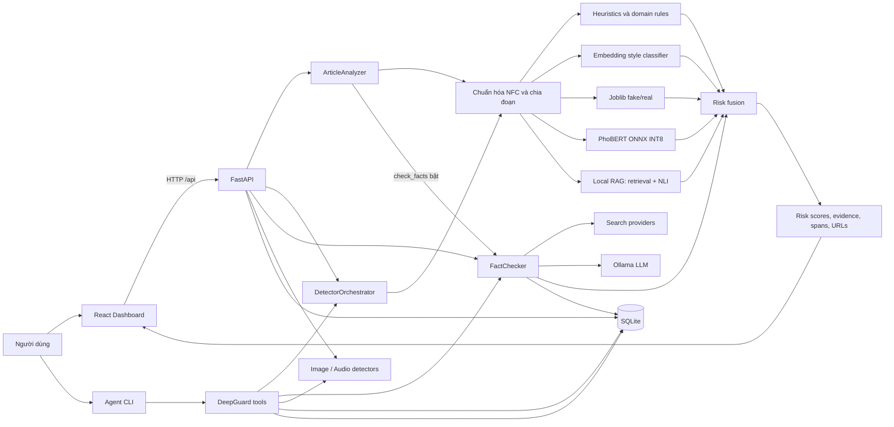

# DeepGuard

DeepGuard là đồ án phân tích nội dung tiếng Việt, gồm Web Dashboard 3.0, REST API và Agent CLI. Hệ thống hỗ trợ rà soát văn bản, phát hiện dấu hiệu tin giả/lừa đảo, tìm kiếm nguồn fact-check và phân tích tệp ảnh bằng model local; mô-đun âm thanh hiện vẫn ở mức heuristic.

> DeepGuard là công cụ sàng lọc, không phải cơ quan xác minh. Điểm rủi ro không bảo đảm đúng/sai. Không dùng kết quả thay cho tư vấn y tế, pháp lý hoặc tài chính.

## Trạng thái tính năng

| Tính năng | Trạng thái hiện tại |
|---|---|
| Phân tích văn bản | Đang hoạt động: luật heuristic, chia đoạn, phát hiện cụm từ/tên miền đáng ngờ, fusion và giải thích. |
| Embedding tiếng Việt | Tùy chọn; dùng sentence-transformers nếu cài và tải được model. Nếu không có, bước này bị bỏ qua. |
| Joblib fake/real | Tùy chọn; chỉ nạp khi đặt `DEEPGUARD_LANGUAGE_MODEL_PATH`. Model cũ có thể không tổng quát ngoài miền dữ liệu huấn luyện. |
| PhoBERT ONNX INT8 | Có loader, script fine-tune và quantize; cần tự chuẩn bị checkpoint đã huấn luyện và cấu hình đường dẫn. Repo không kèm weights. |
| Fact-check web | Có pipeline trích xuất luận điểm, tìm kiếm nguồn, xếp hạng và đánh giá bằng Ollama; cần Ollama/model khi dùng. |
| Local RAG + FAISS/NLI | Tùy chọn; cần corpus JSONL và model NLI ONNX do người dùng cung cấp. Chưa có corpus/model mặc định trong repo. |
| Dashboard 3.0 | Giao diện React có ba chế độ: văn bản, hình ảnh và âm thanh; upload/submit thật gửi dữ liệu tới API, không có nhãn prototype hoặc kết quả media mô phỏng. |
| Phân tích ảnh | Có thể nạp checkpoint ResNet18 hoặc ConvNeXt-Tiny hai lớp; quét toàn ảnh và sliding patches, kết hợp phân tích màu/nhịp phổ, EXIF và sinh bản đồ nhiệt/khung chú thích Grad-CAM. |
| Phân tích âm thanh | Chưa có model deepfake giọng nói; detector hiện trả điểm theo kích thước file và metadata cơ bản. Không nên hiểu kết quả là xác suất clone/AI voice đã hiệu chuẩn. |
| Agent CLI | Có; dùng Ollama để chat và gọi tools phân tích/fact-check/lịch sử. |

Dashboard hiển thị danh sách thành phần AI thực sự chạy. Nếu chưa cấu hình model, kết quả có thể chỉ dựa trên luật và heuristic; hệ thống không giả vờ rằng PhoBERT/NLI đang chạy.

## Công nghệ

- Frontend: React 19, TypeScript, Vite, Lucide icons.
- Backend: Python, FastAPI, Pydantic, Uvicorn.
- NLP cơ bản: regex/heuristics, PyVi; có thể dùng underthesea và sentence-transformers.
- Phân loại tùy chọn: scikit-learn/joblib hoặc PhoBERT qua ONNX Runtime CPU.
- Fact-check: DDGS/news search, cosine retrieval, Ollama; local retrieval tùy chọn dùng FAISS và NLI ONNX.
- Persistence: SQLite; migration đặt tại `backend/migrations/`.
- Kiểm thử: pytest, FastAPI TestClient; frontend dùng TypeScript build và Oxlint.

## Yêu cầu

- Windows PowerShell, Python tương thích với dependencies trong `backend/requirements.txt` (Dockerfile dùng Python 3.14), Node.js/npm.
- Ollama chỉ cần nếu dùng web fact-check hoặc Agent CLI.
- Model embedding, PhoBERT và NLI không bắt buộc để chạy luật cơ bản.

## Cài đặt và chạy local

Mở hai terminal từ thư mục gốc repo. Lệnh `cd backend` chỉ chạy khi terminal đang ở repo root; nếu prompt đã kết thúc bằng `\backend>`, bỏ qua lệnh `cd backend`.

### Terminal 1: API

```powershell
cd backend
python -m pip install -r requirements.txt
$env:PYTHONPATH = (Get-Location).Path
$env:DEEPGUARD_DB_PATH = "..\data\deepguard.db"
$env:DEEPGUARD_UPLOAD_DIR = "..\data\uploads"
python -m uvicorn app.main:app --host 127.0.0.1 --port 8000 --reload --reload-dir app
```

Khi đã đứng trong `backend`, chạy từ dòng `$env:PYTHONPATH = ...`. `--reload-dir app` giới hạn auto-reload vào mã ứng dụng; thay đổi test sẽ không làm server restart.

### Terminal 2: Dashboard dev server

```powershell
cd frontend
npm install
npm run dev -- --host 127.0.0.1
```

Mở [http://127.0.0.1:5173](http://127.0.0.1:5173). Vite đã proxy đường dẫn `/api` về `http://127.0.0.1:8000`; cần để cả hai terminal chạy. Nếu đã ở `frontend`, không chạy lại `cd frontend`.

API có tại [http://127.0.0.1:8000](http://127.0.0.1:8000), tài liệu Swagger tại [http://127.0.0.1:8000/docs](http://127.0.0.1:8000/docs).

### Chạy Dashboard đã build bằng một server

```powershell
cd frontend
npm install
npm run build
cd ..\backend
python -m pip install -r requirements.txt
python -m uvicorn app.main:app --host 127.0.0.1 --port 8000
```

FastAPI phục vụ `frontend/dist` nếu thư mục này tồn tại lúc API khởi động. Khi phát triển UI, dùng Vite dev server thay vì build lại mỗi lần.

### Dừng server

Nhấn `Ctrl+C` trong terminal đang chạy server. Nếu Uvicorn in `WatchFiles detected changes ... Reloading`, đó là thông báo auto-reload bình thường; `Application startup complete` nghĩa là server đã khởi động lại xong.

Nếu cổng 8000/5173 đang bị chiếm, dừng server cũ hoặc chọn cổng khác. Nếu chọn cổng API khác, cập nhật `frontend/vite.config.ts` hoặc `VITE_API_URL` tương ứng.

## Chạy với Docker Compose

```powershell
docker compose up --build
```

Compose hiện chỉ dựng backend API trên cổng 8000 và mount thư mục `data/` vào container. Nó không build frontend; muốn có Dashboard trong trình duyệt, hãy chạy frontend riêng như phần trên hoặc tự build/copy `frontend/dist` vào image.

## Cấu hình môi trường

Ứng dụng đọc biến môi trường của process. `.env.example` là mẫu tham khảo, nhưng Python hiện không tự nạp file `.env`.

| Biến | Ý nghĩa | Mặc định |
|---|---|---|
| `DEEPGUARD_DB_PATH` | Đường dẫn SQLite; tương đối với current working directory. | `./data/deepguard.db` |
| `DEEPGUARD_UPLOAD_DIR` | Thư mục upload. | `./data/uploads` |
| `DEEPGUARD_LANGUAGE_MODEL_PATH` | Joblib model fake/real tùy chọn; chỉ nạp khi đặt rõ ràng. | Tắt |
| `DEEPGUARD_EMBEDDING_MODEL` | Model sentence-transformers cho embedding. Giá trị `off` để tắt. | `bkai-foundation-models/vietnamese-bi-encoder` |
| `DEEPGUARD_PHOBERT_ONNX_DIR` | Thư mục model text-classification ONNX INT8. | Tắt |
| `DEEPGUARD_REFERENCE_CORPUS` | File JSONL corpus cho Local RAG. | Tắt |
| `DEEPGUARD_NLI_ONNX_DIR` | Thư mục model NLI ONNX. | Tắt |
| `DEEPGUARD_IMAGE_MODEL_PATH` | Checkpoint ảnh hai lớp tương thích ResNet18 hoặc ConvNeXt-Tiny. Nếu không đặt, hệ thống ưu tiên `image-service/detector.pt`, sau đó `backend/models/detector.pt`. | Tự phát hiện checkpoint hiện có |
| `OLLAMA_HOST` | Địa chỉ Ollama. | `http://localhost:11434` |
| `DEEPGUARD_AGENT_MODEL` | Ollama model dùng cho Agent và fact-check. | `qwen2.5:3b` |

Ví dụ cấu hình model joblib trong PowerShell từ thư mục `backend`:

```powershell
$env:DEEPGUARD_LANGUAGE_MODEL_PATH = (Resolve-Path '.\data\models\vietnam_fake_news_risk_v3.joblib').Path
```

Model fake/real cũ có thể chấm điểm sai tin thuộc miền khác. Chỉ bật sau khi đã đánh giá trên test set phù hợp; không bật chỉ để hiển thị trạng thái AI.

## Cách phân tích và cách hiểu điểm

1. Văn bản được chuẩn hóa Unicode NFC, bỏ ký tự điều khiển, chuẩn hóa khoảng trắng và tách từ nếu tokenizer tiếng Việt có sẵn.
2. Heuristic phát hiện các nhóm như giật gân, nguồn nặc danh, ngôn từ khẩn cấp/đe dọa, yêu cầu OTP/chuyển tiền, URL rút gọn và domain giả mạo thương hiệu.
3. Embedding style classifier, joblib, PhoBERT và Local RAG chỉ chạy nếu dependency/artifact tương ứng có sẵn và được cấu hình.
4. Fraud, style và factuality được giữ thành các trục riêng. Khi PhoBERT/Local RAG hoạt động, fusion dùng Noisy-OR; đường legacy giữ công thức hiện tại để không thay đổi hiệu chuẩn khi model mới chưa bật.
5. Nhãn: `SAFE` dưới 30%; `SUSPICIOUS` từ 30% đến dưới 70%; `DANGEROUS` từ 70% trở lên.

Điểm số là tín hiệu sàng lọc, không phải xác suất đã hiệu chuẩn cho mọi miền văn bản. Kết quả fact-check dựa trên luận điểm trích xuất và snippets; hãy mở nguồn để kiểm tra ngữ cảnh đầy đủ.

## Sử dụng Dashboard 3.0

- Chọn chế độ **Văn bản**, **Hình ảnh** hoặc **Âm thanh** từ thanh điều hướng.
- Chế độ văn bản cho phép chọn bài mẫu có sẵn hoặc dán tiêu đề/nội dung tự chọn. Tùy chọn fact-check bật pipeline trích luận điểm, tìm nguồn và Ollama; kết quả hiển thị rủi ro toàn bài/theo đoạn, style/fraud/factuality, cụm từ được highlight, claims và nguồn đối chiếu.
- Chế độ hình ảnh nhận `JPG`, `JPEG`, `PNG`, `WEBP`, `BMP`. API đọc nội dung ảnh, chạy checkpoint ResNet18/ConvNeXt hiện có, quét patches và phân tích màu/tần số/metadata. Kết quả có điểm rủi ro, nhãn, bằng chứng và hai khối XAI: heatmap Grad-CAM và ảnh có vùng/bounding box đáng ngờ khi có dữ liệu phù hợp.
- Chế độ âm thanh hiện nhận tệp tải lên và gọi API, nhưng chưa có model deepfake giọng nói hay phân tích waveform thực. Điểm/kết luận chỉ mang tính heuristic theo kích thước và metadata file, không được dùng làm bằng chứng voice clone.
- Nút “Bắt đầu phân tích” gửi tệp/nội dung thật tới backend. Không còn tạo kết quả giả, bài mẫu media hoặc trạng thái mô phỏng khi người dùng tải tệp.
- “Detector” trong kết quả cho biết implementation thực sự tham gia xử lý. Khi model tùy chọn chưa nạp, Dashboard vẫn có thể hiển thị kết quả dựa trên heuristic/luật thay vì báo thành phần đó đang chạy.

## REST API

Các endpoint chính:

| Method | Endpoint | Mô tả |
|---|---|---|
| `GET` | `/api/health` | Trạng thái API, SQLite và filesystem. |
| `GET` | `/api/version` | Phiên bản API và detector contract. |
| `POST` | `/api/analyze/article` | Phân tích bài viết theo đoạn; tùy chọn `check_facts`. |
| `POST` | `/api/analyze/text` | Phân tích một đoạn text, giới hạn 5.000 ký tự; `check_facts` mặc định false. |
| `POST` | `/api/analyze/media` | Upload file với multipart fields `file`, `modality` (`Image` hoặc `Audio`). |
| `POST` | `/api/fact-check/text` | Trích xuất và kiểm chứng claims, tối đa 30.000 ký tự. |
| `GET` | `/api/fact-checks` | Liệt kê fact-check reports. |
| `GET` | `/api/fact-checks/{report_id}` | Xem một report. |
| `GET` | `/api/analyses` | Liệt kê kết quả, lọc tùy chọn `modality`, `risk`. |
| `GET` | `/api/analyses/{analysis_id}` | Lấy một kết quả đã lưu. |

Ví dụ gọi article API từ PowerShell:

```powershell
$body = @{
  title = 'Thông báo kiểm tra an toàn thực phẩm'
  text = 'Sở Y tế khuyến cáo người dân chọn cửa hàng có giấy phép.'
  check_facts = $false
} | ConvertTo-Json -Compress

Invoke-RestMethod -Uri 'http://127.0.0.1:8000/api/analyze/article' `
  -Method Post -ContentType 'application/json' -Body $body
```

Article response có `summary`, `paragraphs`, `claims`, `ai_components`, `matched_reference_urls` và recommendations. Mỗi paragraph có `style_risk`, `fraud_risk`, `factuality_risk`, `phobert_fraud_score` (phần trăm hoặc `null`), issues và `suspicious_phrases` với span `start`/`end`.

## Fact-check bằng Ollama

Fact-check web và Agent CLI dùng Ollama model mặc định `qwen2.5:3b`. Cài Ollama, sau đó:

```powershell
ollama pull qwen2.5:3b
ollama serve
```

Giữ Ollama chạy ở terminal riêng. Nếu dùng model khác, đặt `DEEPGUARD_AGENT_MODEL`. Fact-check tìm nguồn qua provider web, xếp hạng snippets theo độ liên quan rồi yêu cầu model đánh giá; không có kết quả tìm kiếm không đồng nghĩa claim sai.

## Agent CLI

Từ thư mục gốc:

```powershell
cd backend
python -m pip install -r requirements.txt
ollama pull qwen2.5:3b
python -m app.agent.cli
```

Ví dụ: `Hãy phân tích: "Tài khoản sẽ bị khóa, hãy gửi mã OTP."` hoặc `Hãy kiểm chứng: "Sự kiện X xảy ra tại Hà Nội năm 2024."`. Gõ `/exit` để thoát. Tools của Agent gồm phân tích text, fact-check, phân tích file local Image/Audio, liệt kê và lấy lịch sử.

## Dataset

Dataset nằm ở `data/language/`:

- `raw/vifactcheck/`: Parquet gốc của ViFactCheck (MIT).
- `raw/viwikifc/`: CSV gốc của ViWikiFC (CC-BY-4.0, cần ghi công).
- `processed/claims_{train,val,test}.csv`: claim/evidence/context với nhãn `SUPPORTED`, `REFUTED`, `NEI`; phù hợp cho nghiên cứu fact-check/NLI, không phải nhãn scam/phishing.
- `processed/news_{train,val,test}.csv`: fake/real từ Fake_news_data; hiện khoảng 1.178 mẫu theo manifest, chưa đủ để fine-tune PhoBERT quy mô lớn và cần xác nhận quyền sử dụng dữ liệu.

Trong bản dữ liệu hiện tại, claims có 21.862 mẫu train, 3.000 validation, 2.932 test; từng record có evidence và URL. Lưu ý manifest hiện ghi nguồn `fake_news_data` trong khi claims CSV chứa `vifactcheck` và `viwikifc`; chạy lại pipeline để đồng bộ manifest trước khi trích dẫn thống kê hoặc tái tạo dataset.

Tái tạo claims từ raw files, chạy từ `backend`:

```powershell
python -m pip install -r requirements-data.txt
python -m app.detectors.language.data_pipeline
```

Mặc định pipeline dùng nguồn mở ViFactCheck và ViWikiFC, chuẩn hóa nhãn, khử trùng lặp/xung đột và chia train/validation/test. Chỉ thêm `fake_news_data` qua `--sources` sau khi xác nhận quyền sử dụng. Không gộp `SUPPORTED/REFUTED/NEI` vào `safe/risky`.

## Huấn luyện classifier

### Classifier TF-IDF/joblib

Script train hiện tại dùng TF-IDF unigram/bigram và Logistic Regression. Chạy từ `backend` với nhãn Fake_news_data đã xác nhận (`0=fake`, `1=real`):

```powershell
python -m app.detectors.language.train ..\data\TEXT\Fake_news_data\update_train_data.csv `
  --text-column Maintext --label-column Label `
  --risky-label 0 --safe-label 1 `
  --validation-dataset ..\data\TEXT\Fake_news_data\update_val_data.csv `
  --output data\models\vietnam_fake_news_risk.joblib
```

Đánh giá trên tập test riêng:

```powershell
python -m app.detectors.language.train ..\data\TEXT\Fake_news_data\fix_test_data.csv `
  --text-column Maintext --label-column Label `
  --risky-label 0 --safe-label 1 `
  --evaluate-model data\models\vietnam_fake_news_risk.joblib
```

Để dùng model đã train, đặt `DEEPGUARD_LANGUAGE_MODEL_PATH` trỏ đến file joblib trước khi khởi động backend. Đánh giá precision/recall/F1 và false positive trên dữ liệu ngoài train trước khi bật.

### PhoBERT và ONNX INT8 (tùy chọn)

Cài inference dependencies từ `backend`:

```powershell
python -m pip install -r requirements-ml.txt
```

Fine-tune script yêu cầu 10.000–20.000 mẫu nhị phân sau khi dedup. Cần dataset scam/phishing có license và mapping nhãn phù hợp; dữ liệu fact-check không thay thế được nhãn fraud.

```powershell
python -m app.detectors.language.train_phobert `
  --dataset path\to\safe-and-risky.csv `
  --text-column text --label-column label `
  --risky-label risky --safe-label safe `
  --output data\models\phobert-fraud-finetuned

optimum-cli export onnx `
  --model data\models\phobert-fraud-finetuned `
  --task text-classification phobert_onnx

python -m app.detectors.language.quantize_onnx phobert_onnx phobert_onnx_int8
$env:DEEPGUARD_PHOBERT_ONNX_DIR = (Resolve-Path 'phobert_onnx_int8').Path
```

Model chạy ONNX Runtime CPU. Chưa có artifact trong repo; latency/RAM phải benchmark trên máy triển khai, không giả định luôn đạt một con số cố định.

## Local RAG và NLI (tùy chọn)

Local reference corpus là JSONL, một object mỗi dòng:

```json
{"text":"Đoạn nội dung được phép sử dụng","title":"Tiêu đề nguồn","url":"https://tuoitre.vn/...","published_at":"2025-01-01"}
```

Chỉ thêm nội dung có quyền sử dụng. Cấu hình `DEEPGUARD_REFERENCE_CORPUS` trỏ tới file JSONL, `DEEPGUARD_NLI_ONNX_DIR` trỏ tới model ONNX có nhãn entailment/neutral/contradiction. Hệ thống truy xuất tối đa top-3 bằng FAISS nếu cài, nếu không dùng cosine; chỉ domain trong allowlist của code mới có thể làm nguồn trusted để giảm cảnh báo. Thiếu corpus hoặc NLI model thì Local RAG không đóng góp điểm.

## Kiến trúc hệ thống

DeepGuard chia thành giao diện, lớp API/điều phối, các detector độc lập và lớp lưu trữ. Model PhoBERT, joblib, embedding và Local RAG là thành phần tùy chọn; chúng chỉ tham gia khi dependency và artifact tương ứng được cấu hình.



### Các luồng chính

1. **Phân tích bài viết trên Dashboard:** React gửi `POST /api/analyze/article`. `ArticleAnalyzer` chuẩn hóa và chia đoạn, chạy rules và các classifier khả dụng, có thể gọi FactChecker nếu `check_facts=true`, sau đó tổng hợp kết quả và spans để hiển thị. Báo cáo fact-check được lưu trong SQLite.
2. **Phân tích text API:** `POST /api/analyze/text` đi qua `DetectorOrchestrator` đến `LanguageDetector`; kết quả phân tích được lưu vào bảng analyses. Đây là API khác với luồng article theo đoạn.
3. **Fact-check:** `FactChecker` trích xuất luận điểm, tìm kiếm nguồn bên ngoài, xếp hạng snippets theo độ liên quan rồi yêu cầu Ollama đánh giá. Search result/snippet không thay thế việc đọc bài gốc.
4. **PhoBERT và Local RAG:** PhoBERT ONNX bổ sung fraud score cho toàn câu. Local RAG truy xuất top-3 đoạn từ corpus JSONL, dùng embedding/FAISS và NLI ONNX để chấm entailment/contradiction/factuality. Thiếu model/corpus thì các nhánh này không chạy và không tạo score giả.
5. **Ảnh:** `ImageDetector` nạp ResNet18 hoặc ConvNeXt-Tiny hai lớp, chấm điểm toàn ảnh và các patch, kết hợp color/EXIF/frequency multi-signal rồi sinh Grad-CAM. Checkpoint được ưu tiên từ `DEEPGUARD_IMAGE_MODEL_PATH`, `image-service/detector.pt`, sau đó `backend/models/detector.pt`.
6. **Âm thanh:** `AudioDetector` kiểm tra kích thước và metadata file cơ bản. Đây không phải detector voice-cloning/deepfake; kết quả không nên được báo là “AI voice phát hiện” bằng mô hình chuyên sâu.
6. **Agent CLI:** Ollama hội thoại với người dùng và gọi các tool phân tích, fact-check, phân tích media hoặc truy vấn lịch sử. Agent dùng detector/service backend, không phải một bộ phân loại riêng.

### Các trục rủi ro

- `style_risk`: cách diễn đạt giật gân, nguồn nặc danh, kích động hoặc kêu gọi lan truyền.
- `fraud_risk`: dấu hiệu lừa đảo như yêu cầu OTP/chuyển tiền, đe dọa khóa tài khoản, URL rút gọn hoặc domain giả mạo.
- `factuality_risk`: tín hiệu từ model tin giả/fact-check; có thể chưa xác minh (`null`) nếu không có bằng chứng.
- Fusion giữ ba trục riêng. Khi PhoBERT hoặc Local RAG chạy, code dùng Noisy-OR cho các tín hiệu tương ứng; nếu không, hệ thống giữ công thức legacy đã hiệu chuẩn trước đó. Trusted-source adjustment chỉ được xét khi NLI xác nhận entailment từ domain allowlist và không có contradiction mạnh.
- Kết quả giải thích gồm evidence, phrase spans, `ai_components` và URL nguồn nếu có. `ai_components` cho biết thành phần nào thực sự chạy trong request.

### Nguyên lý, công thức và lựa chọn công cụ

Phần này mô tả công thức đang được triển khai, không phải cam kết rằng các điểm đã được hiệu chuẩn như xác suất trong môi trường thực tế. Các trọng số và ngưỡng dưới đây là tham số hiện tại của dự án, cần được đánh giá lại khi thay dataset hoặc model.

#### 1. Chuẩn hóa và tách từ

- **Unicode NFC:** tiếng Việt có thể được biểu diễn bằng ký tự dựng sẵn hoặc ký tự dấu kết hợp. Chuẩn hóa NFC đưa các cách biểu diễn tương đương về dạng thống nhất để regex, so khớp từ và tokenizer ít bỏ sót hơn.
- **Loại ký tự điều khiển, chuẩn hóa khoảng trắng:** giúp tránh dữ liệu rác làm hỏng so khớp hoặc tokenization nhưng vẫn giữ văn bản sạch để tạo span và bằng chứng.
- **Tách từ tiếng Việt:** dùng underthesea nếu có, sau đó dùng PyVi; cuối cùng fallback sang khoảng trắng. Tiếng Việt có từ ghép nhiều âm tiết, nên tách từ hữu ích cho embedding/model. Fallback đảm bảo ứng dụng vẫn chạy nhưng chất lượng ngữ nghĩa có thể giảm.
- `start`/`end` của suspicious phrases là offset trên văn bản đầu vào đã phân tích. UI dùng chúng để highlight; đây là vị trí của regex match, không phải vùng giải thích do LLM sinh ra.

#### 2. Heuristic và domain rules

Regex được chia thành `style` và `fraud` vì hai loại tín hiệu trả lời hai câu hỏi khác nhau: văn phong có thao túng không, và nội dung có hành vi lừa đảo trực tiếp không.

| Nhóm rule | Điểm cộng hiện tại | Ví dụ tín hiệu |
|---|---:|---|
| Ngôn từ khẩn cấp/hứa thưởng | 0.35 fraud | “xác minh ngay”, “trúng thưởng” |
| Đe dọa tài khoản | 0.40 fraud | “tài khoản sẽ bị khóa”, đe dọa phạt/khởi tố |
| Yêu cầu dữ liệu nhạy cảm | 0.40 fraud | OTP, mật khẩu, chuyển tiền |
| Giật gân | 0.30 style | “cực sốc”, “chấn động” |
| Nguồn nặc danh/tin đồn | 0.35 style | “chuyên gia giấu tên”, “nghe nói” |
| Kêu gọi lan truyền | 0.25 style | “chia sẻ gấp”, “kẻo muộn” |
| Thuyết âm mưu/khẳng định thần dược | 0.45 style | “bị bịt mắt”, “chữa khỏi 100%” |

Mỗi nhóm được tính tối đa một lần cho văn bản, kể cả khi nhiều pattern trong nhóm cùng khớp; các nhóm khác nhau được cộng lại và tổng rule score bị chặn ở 0.95. Những con số này là **điểm heuristic**, không phải xác suất thống kê. Cách tính theo nhóm tránh một cụm bị lặp nhiều lần làm điểm tăng vô hạn; chia style/fraud giúp không kết luận một bài chỉ vì văn phong giật gân là lừa đảo.

Domain checks kết hợp danh sách tên miền chính thức, danh sách shortener, chuẩn hóa ký tự giống nhau (`0/o`, `1/i`, `rn/m`...) và khoảng cách Levenshtein. Levenshtein là số phép thêm/xóa/thay ký tự tối thiểu để biến chuỗi này thành chuỗi kia; nó giúp bắt typo-squatting như tên ngân hàng gần giống. Tên miền chính thức và subdomain của nó được loại trước để tránh tự gắn cờ nhầm. Danh sách thương hiệu hiện hữu hạn nên không thay thế kiểm tra chứng thư, chủ sở hữu domain hay danh sách cập nhật từ nhà cung cấp.

#### 3. Embedding và prototype classifier

Bi-encoder sentence-transformers chuyển câu thành vector số. Độ gần giữa hai vector được đo bằng cosine similarity:

```text
cosine(a, b) = (a · b) / (||a|| × ||b||)
```

Cosine gần 1 nghĩa là hai vector cùng hướng/ngữ nghĩa gần theo model; gần 0 nghĩa là ít tương đồng. Dùng vector thay vì chỉ so chuỗi giúp phát hiện cách diễn đạt mới gần với ví dụ lừa đảo/giật gân dù từ ngữ không hoàn toàn trùng.

`EmbeddingStyleClassifier` so câu đầu vào với các prototype của ba nhóm `sensational`, `scam`, `neutral`, lấy cosine cao nhất trong mỗi nhóm rồi chuẩn hóa bằng softmax:

```text
P(category) = exp(best_similarity / T) / sum(exp(best_similarity_i / T))
T = 0.05
```

Temperature thấp làm chênh lệch similarity rõ hơn trong phân phối giữa ba nhóm. Các số trả về là **độ nghiêng tương đối giữa prototype**, không phải xác suất scam đã hiệu chuẩn. Prototype giúp có baseline nhẹ, dễ giải thích và không cần huấn luyện; nhược điểm là chất lượng phụ thuộc ví dụ prototype và model embedding.

Nếu không tải được bi-encoder, code có thể fallback sang TF-IDF character n-gram (n-gram ký tự dài 2–4). TF-IDF hữu ích để so văn bản bề mặt/offline, nhưng không hiểu ngữ nghĩa thực sự và có thể nhầm khi diễn đạt khác từ vựng.

#### 4. Fact-check web

Fact-check web là luồng **trích xuất luận điểm → tìm kiếm → xếp hạng evidence → đánh giá stance**, không phải bộ phân loại fraud:

1. Ollama trích tối đa 5 luận điểm có thể kiểm chứng; mỗi luận điểm tìm tối đa 3 kết quả.
2. Bing News RSS là provider ưu tiên, DDGS là fallback. Danh sách publisher ưu tiên được dùng để chọn nguồn và xác định evidence phù hợp; search snippet vẫn có thể thiếu ngữ cảnh hoặc sai.
3. Claim và snippet được vector hóa rồi xếp hạng bằng cosine. Snippet similarity thấp hoặc thiếu chi tiết phân biệt bị hạ từ `supports`/`contradicts` thành `context`, để tránh kết luận chỉ dựa vào kết quả tìm kiếm không liên quan.
4. Ollama gán stance cho từng nguồn. Nếu có cả nguồn ủng hộ lẫn mâu thuẫn, verdict là `mixed`; nếu không có stance rõ, kết quả là `insufficient_evidence`.

Mapping verdict thành risk hiện tại:

| Verdict | Risk dùng trong factuality |
|---|---:|
| `supported` | 0.0 |
| `mixed` | 0.6 |
| `contradicted` | 1.0 |
| `insufficient_evidence` | Không đưa vào trung bình; nếu không có verdict rõ thì factuality là `null` |

Các luận điểm có verdict rõ được gộp theo trung bình trọng số:

```text
weight_i = max(confidence_i, 0.05)
factuality_risk = sum(verdict_risk_i × weight_i) / sum(weight_i)
```

`0.05` chỉ để một verdict confidence rất thấp vẫn có trọng số nhỏ thay vì bị chia cho 0. Confidence report còn xét coverage: trung bình confidence của claim rõ ràng nhân tỷ lệ claim có kết luận trên tổng claim. Khi kết hợp fact-check với model score, confidence của report làm trọng số nhưng bị giới hạn tối đa 0.8:

```text
combined = fact_check_risk × w + model_score × (1 - w)
w = clamp(fact_check_confidence, 0, 0.8)
```

Nếu chỉ có một nguồn điểm thì dùng nguồn đó; nếu không có cả hai thì kết quả để `null`. Giới hạn 0.8 ngăn một report tự động ghi đè hoàn toàn model score. Các hệ số này là chính sách hiện tại, không chứng minh search/LLM luôn đúng.

#### 5. PhoBERT và ONNX INT8

PhoBERT text classifier được thiết kế để ước lượng `dl_fraud_prob` từ toàn câu, bổ sung cho rule bắt từ khóa. ONNX Runtime chạy model đã export trên CPU; dynamic quantization INT8 giảm độ rộng biểu diễn trọng số để giảm footprint bộ nhớ và thường tăng tốc trên CPU. Đổi lại có thể mất một phần độ chính xác; cần benchmark latency, RAM và chất lượng trên tập test thực tế.

Model trả logits `z_i`; code đổi chúng thành score bằng softmax ổn định số học:

```text
P_i = exp(z_i - max(z)) / sum(exp(z_j - max(z)))
```

`P(risky)` chỉ đáng tin trong miền dữ liệu mà model đã huấn luyện/đánh giá. Dùng model fake-news cho phishing hoặc ngược lại là domain shift; điểm cao trên tin chính thống có thể là false positive. Vì vậy joblib cũ không tự nạp, PhoBERT cũng chỉ báo có hoạt động khi checkpoint ONNX thực sự được cấu hình.

#### 6. Local RAG, FAISS và NLI

- **Retrieval:** corpus JSONL chứa text và metadata. Bi-encoder mã hóa query/reference; FAISS `IndexFlatIP` tìm inner product. Khi vector đã chuẩn hóa L2, inner product bằng cosine similarity. Code lấy top-3; similarity dưới 0.35 bị bỏ qua. Nếu không có FAISS thì dùng cosine trực tiếp. Với TF-IDF fallback, query và references phải được vector hóa cùng vocabulary để vector có cùng không gian.
- **NLI:** cặp `(reference, input)` được đưa vào model để phân loại `entailment`, `neutral` hoặc `contradiction`. Đây là bước kiểm tra quan hệ hai câu sau retrieval; retrieval đơn thuần chỉ nói “có vẻ liên quan”, không nói claim đúng.
- Ngưỡng NLI hiện tại là 0.75. Contradiction mạnh tạo `factuality_risk=0.85`; entailment mạnh từ URL thuộc allowlist và không có contradiction mạnh tạo risk 0.0, nhãn verified; entailment mạnh từ nguồn khác tạo risk 0.15; các trường hợp còn lại để `null`.
- Chỉ URL từ allowlist code mới được tính là trusted. Tên miền allowlist không chứng minh mọi nội dung trên site đều đúng. Trusted-source mitigation là giảm cảnh báo trong trường hợp có evidence phù hợp, không phải xác thực danh tính hay chứng nhận toàn bài.

FAISS được chọn vì chạy local, không cần dịch vụ vector database riêng; nhược điểm là index/corpus nằm trong RAM và cần nạp lại theo process. Corpus cần quyền sử dụng rõ ràng và cập nhật metadata; hiện repo chưa kèm corpus Local RAG mặc định.

#### 7. Risk fusion và ý nghĩa Noisy-OR

Noisy-OR mô hình hóa xác suất có ít nhất một nguyên nhân/tín hiệu gây rủi ro, giả định các tín hiệu độc lập:

```text
P(any risk) = 1 - product(1 - p_i)
```

Ví dụ hai tín hiệu đều 0.5 cho `1 - (1 - 0.5)^2 = 0.75`. Ưu điểm là evidence bổ sung làm risk tăng dần thay vì chỉ chọn `max`; nhược điểm là các detector thường tương quan, nên giả định độc lập có thể cộng dồn quá mức. Không nên coi output là xác suất calibrated nếu chưa hiệu chuẩn trên dữ liệu đại diện.

Code đang giữ hai chế độ để không âm thầm đổi hiệu chuẩn cũ:

**Legacy path** khi PhoBERT và Local RAG không hoạt động:

```text
legacy_noisy_or(rule, nlp) = min(0.95, 1 - (1 - rule) × (1 - 0.6 × nlp))
fraud_risk = legacy_noisy_or(rule_fraud, embedding_scam)
style_risk = legacy_noisy_or(rule_style, embedding_sensational)

Nếu factuality có giá trị:
  content_risk = max(factuality_risk,
                     0.35 × style_risk + 0.65 × factuality_risk)
Nếu factuality chưa có:
  content_risk = style_risk

overall = min(0.95, max(fraud_risk, content_risk))
```

Hệ số `0.6` giảm ảnh hưởng embedding prototype vì chưa được hiệu chuẩn như xác suất; cap `0.95` tránh score chạm tuyệt đối. Khi factuality đã có, trọng số 0.65 dành nhiều ảnh hưởng hơn cho thông tin đúng/sai, còn 0.35 cho văn phong. Fraud được giữ riêng vì một tin có nội dung đúng vẫn có thể yêu cầu OTP hoặc chuyển tiền. Đây là trọng số thiết kế, không phải kết quả tối ưu hóa thống kê.

**Multilayer path** khi PhoBERT hoặc Local RAG thực sự hoạt động:

```text
fraud_risk = NoisyOR(rule_fraud, dl_fraud_prob)
overall = NoisyOR(style_risk, fraud_risk, factuality_risk)
```

Nếu Local RAG xác nhận entailment mạnh từ trusted domain và không có contradiction mạnh, code nhân `style_risk` và `fraud_risk` với 0.3, đặt `factuality_risk=0`; mục tiêu là giảm false positive khi nội dung cảnh báo hợp pháp nhắc đến từ nhạy cảm như OTP. Vì đây là mitigation mạnh, nó chỉ nên dùng với model NLI/corpus được đánh giá tốt; nếu model NLI hoặc corpus sai, risk có thể bị giảm sai.

Label thresholds hiện tại: dưới 0.30 là `SAFE`; từ 0.30 đến dưới 0.70 là `SUSPICIOUS`; từ 0.70 là `DANGEROUS`. Đây là ngưỡng sản phẩm dễ diễn giải, chưa phải ngưỡng được chọn qua đánh giá cost-sensitive trên người dùng thật.

**Gộp paragraph thành article:** `ArticleAnalyzer` không lấy trung bình đơn giản cho mọi trục:

```text
article_style = 0.6 × max(paragraph_style) + 0.4 × mean(paragraph_style)
article_model = mean(model_score của các paragraph có score)
article_fraud = max(paragraph_fraud)
```

`max` giữ lại một đoạn có dấu hiệu lừa đảo mạnh để không bị các đoạn trung tính làm loãng; phần mean style phản ánh mức độ lặp lại của văn phong, còn max style giữ ảnh hưởng của đoạn nghiêm trọng nhất. Model score được lấy trung bình trên các đoạn có model output vì factuality là đánh giá nội dung toàn bài hơn là dấu hiệu nguy hiểm cục bộ. Sau đó article-level fact-check report được kết hợp với article model score theo confidence; nếu Local RAG có điểm thì risk lớn nhất từ các đoạn RAG được kết hợp thêm. Đây là lựa chọn hiện tại, cần đánh giá nếu thay đổi cách chia đoạn hoặc độ dài bài.

#### 8. Lý do chọn các công cụ nền

| Công cụ/ý tưởng | Vì sao dùng | Giới hạn/đánh đổi |
|---|---|---|
| FastAPI + Pydantic | REST API gọn, schema/validation rõ, tích hợp thuận tiện với React và OpenAPI. | Không tự làm cho detector chính xác hơn. |
| React + TypeScript + Vite | Dashboard tương tác, type-check response, dev server/proxy nhanh. | Cần chạy API riêng khi dùng Vite dev mode. |
| SQLite | Local-first, không cần cài database server; lưu analyses và fact-check reports. | Không phù hợp làm kho vector lớn hoặc tải ghi đa người dùng cao. |
| Regex + heuristics | Nhanh, rẻ, có thể giải thích bằng cụm từ/span cụ thể; tốt cho dấu hiệu rõ như URL rút gọn/OTP. | Không hiểu ngữ cảnh; từ nhạy cảm trong cảnh báo hợp pháp có thể bị gắn cờ. |
| Sentence embeddings | Bắt tương đồng ngữ nghĩa tốt hơn so chuỗi chính xác, dùng chung cho prototype/retrieval. | Chất lượng phụ thuộc model; similarity không phải entailment hay xác suất đúng. |
| FAISS | Top-k vector search cục bộ với IndexFlatIP, ít thành phần vận hành. | Index nằm trong RAM, cần rebuild/nạp lại khi corpus thay đổi. |
| ONNX Runtime + INT8 | Phân phối inference CPU và giảm footprint so với model FP32. | Cần export đúng model/tokenizer; lượng tử hóa có thể giảm chất lượng, phải đo trên phần cứng thật. |
| Ollama | Chạy LLM local cho trích xuất claim và đánh giá evidence mà không cần API key cloud. | Cần tải model và tài nguyên máy; output LLM không phải bằng chứng và vẫn có thể sai. |
| Pytest/TestClient | Kiểm tra logic và API offline bằng dữ liệu/mocks, không cần gọi dịch vụ thật. | Test mock không chứng minh chất lượng model, search hoặc latency ngoài đời. |

**Luồng xử lý tóm tắt:** chuẩn hóa → rules/embedding/model tùy chọn → retrieval/fact-check tùy chọn → fusion → label, evidence và spans. Khi debug false positive, xem từng thành phần (`style_risk`, `fraud_risk`, `factuality_risk`, `ai_components`) trước khi đổi ngưỡng tổng; nếu không, một model sai có thể bị che bởi score cuối.

### Thành phần trong mã nguồn

- `frontend/src/`: giao diện React, bài mẫu, Dashboard và kết nối REST API qua Vite proxy.
- `backend/app/main.py`: khai báo FastAPI routes và nối các service dùng chung.
- `backend/app/services/article_analyzer.py`: điều phối phân tích bài theo đoạn và tổng hợp kết quả article.
- `backend/app/services/orchestrator.py`: điều phối text, image và audio detector.
- `backend/app/detectors/language/`: preprocessing NFC/tokenization, heuristics, domain checks, classifier, PhoBERT ONNX và scripts train.
- `backend/app/detectors/image/`: nạp checkpoint ResNet18/ConvNeXt-Tiny, quét patch, phân tích multi-signal và sinh Grad-CAM/XAI.
- `backend/app/detectors/audio/`: kiểm tra metadata/kích thước file; chưa có mô hình phân tích speech/deepfake thực.
- `backend/app/services/risk_fusion.py`: hợp nhất style/fraud/factuality và gán nhãn rủi ro.
- `backend/app/services/fact_checking.py` và `local_rag.py`: fact-check dựa trên search web và Local RAG/NLI tùy chọn.
- `backend/app/db/` và `backend/migrations/`: SQLite store và schema migrations.
- `backend/app/agent/`: Ollama Agent CLI và tool definitions.

## Cấu trúc repository

```text
backend/
  app/main.py                    FastAPI app, routes, service wiring
  app/api/routes/health.py       health/version
  app/agent/                     Ollama CLI và tools
  app/detectors/language/        preprocessing, rules, domains, classifiers, training
  app/detectors/image/           ResNet18/ConvNeXt + patch/color/EXIF/frequency + Grad-CAM XAI
  app/detectors/audio/           size/metadata heuristic; chưa tích hợp model voice/deepfake
  app/services/                  article analyzer, fact-check, fusion, local RAG
  app/db/                        SQLite store và migrations
  tests/                         pytest suite
frontend/                        React/TypeScript Dashboard
data/language/raw/               dữ liệu gốc
data/language/processed/         các split đã xử lý và manifest
backend/data/models/             model artifacts cục bộ
```

## Kiểm thử và build

Backend, chạy từ repo root:

```powershell
python -m pytest backend/tests -q
```

Hoặc từ `backend`:

```powershell
python -m pytest
```

Frontend:

```powershell
cd frontend
npm run lint
npm run build
```

## Troubleshooting

- `cd backend` báo không tìm thấy `backend\backend`: terminal đã ở trong `backend`; bỏ dòng `cd backend`.
- `cd frontend` báo không tìm thấy `frontend\frontend`: terminal đã ở trong `frontend`; bỏ dòng `cd frontend`.
- Uvicorn reload sau khi sửa test: dùng `--reload-dir app`; `WatchFiles detected changes` là thông báo reload, không phải lỗi nếu sau đó có `Application startup complete`.
- Dashboard không gọi được API: giữ backend ở cổng 8000; Vite proxy `/api` trong `frontend/vite.config.ts` đang trỏ tới đó.
- Fact-check báo lỗi kết nối/model: kiểm tra Ollama đang chạy, model đã `ollama pull`, và giá trị `OLLAMA_HOST`/`DEEPGUARD_AGENT_MODEL`.
- Không thấy PhoBERT/RAG trong “Thành phần đã chạy”: cần weights/corpus tương ứng và biến môi trường. Repo không tải sẵn các artifacts này.
- Phân tích ảnh báo `checkpoint not found`: đặt `DEEPGUARD_IMAGE_MODEL_PATH` tới checkpoint hai lớp hợp lệ hoặc đặt file vào `image-service/detector.pt`; backend hỗ trợ ResNet18 và ConvNeXt-Tiny.
- Kết quả âm thanh không có `deepfake` chuyên sâu: đây là giới hạn hiện tại của `audio-heuristic-v1`, không phải lỗi cấu hình model. Cần tích hợp model speech/deepfake riêng trước khi sử dụng kết luận production.
- Cổng bị chiếm: dừng server bằng `Ctrl+C`; chỉ dùng `Stop-Process` nếu đã xác định đúng PID.

## Tài liệu chi tiết

- [Phát hiện ngôn ngữ, heuristic, risk fusion, dataset và model](backend/app/detectors/language/README.md)
- [Cấu trúc repository](docs/architecture/repo-structure.md)
- [Workflow nhóm](docs/workflows/github-workflow-3-people.md)
