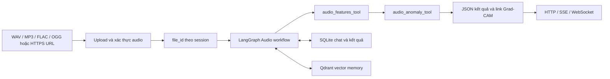

# Bàn giao phần Audio đến tuần 5 — DeepGuard

Nguồn yêu cầu: `DeepGuard_KeHoach_TheoDoi_10Tuan (1).xlsx`, sheet **Phân Công 10 Tuần**,
các dòng 8, 9, 12, 15, 18; hợp đồng JSON ở **Kiến Trúc & Quy Trình**, dòng 14–23.
Đối chiếu ngày 04/10/2026. Không sửa trạng thái, tỷ lệ hoàn thành hoặc điểm của thành viên trong Excel.

## 1. Những thay đổi cần hiểu đúng

Dự án chuyển từ API phân tích đa phương thức sang kiến trúc multi-agent có tools,
bộ nhớ và streaming. Theo phân công chi tiết, **Thành viên 2 (Audio)** không chỉ
làm bộ phân loại: còn phụ trách runtime và memory ở tuần 2. Mã trước lần bàn giao
này có CNN ASVspoof, Grad-CAM, API phân tích và dashboard; chưa có runtime agent,
vector memory hay tool theo schema. Trạng thái “Hoàn thành” trên kế hoạch không
được dùng thay bằng chứng chạy mã.

| Mốc và ô nguồn | Yêu cầu | Bàn giao thực tế |
|---|---|---|
| Tuần 2, D8:K8 | FastAPI + LangGraph/LangChain/CrewAI; HTTP/WebSocket | `core/agents/audio_agent.py`, `app/api/routes/agent.py`, `run_audio_agent.py`: LangGraph, HTTP, SSE và WebSocket |
| Tuần 2, D9:K9 | Vector DB + chat/session memory | `app/db/memory_store.py`: SQLite + Qdrant local; phiên, tin nhắn, file, kết quả; lưu bền và truy xuất có lọc phiên |
| Tuần 3, D12:K12 | WAV/MP3; MFCC, waveform, spectrogram với librosa | `core/tools/audio_features_tool.py`: MFCC 20 hệ số mean/std, min/max waveform, phổ Mel 80 dải có trục thời gian/tần số |
| Tuần 4, D15:K15 | Bất thường tần số + Voice Deepfake, JSON | `core/tools/audio_anomaly_tool.py`: chẩn đoán clipping/năng lượng 6–8 kHz, CNN hiện có, Grad-CAM; model thiếu trả unavailable |
| Tuần 5, D18:K18 | Agent Tool/function calling; truyền binary/URL | `core/tools/registry.py`: LangChain StructuredTool (BaseTool), Pydantic input, schema JSON, endpoint gọi tên tool; file handle cho upload/URL |

Tên `agent_schema.py` dùng để phân biệt với `app/models/schemas.py` của API cũ.
Các deliverable tương đương `models/schema.py` trong kế hoạch nằm ở file này.
`docs/audio_tool_schemas.json` là snapshot schema để bàn giao; `/api/agent/tools`
lấy trực tiếp schema đang chạy. Định dạng snapshot là mô tả registry, không phải
request hoàn chỉnh gửi thẳng tới một dịch vụ LLM.

**Mức hoàn thành:** đã triển khai cơ chế chạy, đóng gói tool và tích hợp theo mốc.
Chất lượng phát hiện của CNN vẫn chưa đạt mức dùng để kết luận. Không đánh đồng
hoàn thành phần mềm tuần 4 với hoàn thành đánh giá độ chính xác của mô hình.

## 2. Kiến trúc và giới hạn của bản chạy này



- Runtime thực sự dùng LangGraph nhưng luồng gọi tool cố định. Phản hồi được tạo
  theo mẫu, không có LLM tự suy luận/chọn tool, không cần API key. Master Router
  đa phương thức nằm ở tuần 7. `core/agents/audio_system_prompt.md` là spec để
  thành viên tích hợp LLM sử dụng sau này, chưa phải prompt được gửi tới LLM.
- Short-term history lưu bằng SQLite. Vector memory dùng Qdrant trên đĩa và
  HashingVectorizer 384 chiều, char n-grams 2–4; đây là **tìm kiếm tương đồng từ/ký tự**,
  không phải embedding ngữ nghĩa pretrained. Kết quả truy xuất được đưa vào
  `metadata.recalledMemory`; không dùng lịch sử để thay đổi điểm CNN.
- Bộ nhớ được lọc theo phiên. Đóng/mở server vẫn giữ dữ liệu trong `data/agent/`.
  SQLite là nguồn chính, vector index được đồng bộ lại khi khởi động. Chỉ chạy
  **một process/worker** với Qdrant local. Chuyển sang Qdrant server trước khi chạy
  nhiều worker. Chưa có migration/retention, đăng nhập hay cô lập theo tài khoản:
  đây là bản local, UUID phiên không phải cơ chế xác thực người dùng.
- WAV/MP3/FLAC/OGG: tối đa 20 MB, 0.5–60 giây, 8–192 kHz, 1–8 kênh, từ chối
  im lặng/NaN. MP3 dùng libsndfile qua soundfile. Feature dùng librosa ở 16 kHz.
  CNN giữ preprocessing cũ; MP3 được giải mã ra WAV float ở sample rate gốc rồi
  đi qua preprocessing CNN. Không thay phổ huấn luyện bằng phổ librosa.
- Upload, history và ảnh XAI lưu trên máy, nằm trong `.gitignore`. Kết quả JSON
  giữ phổ đã lấy mẫu tối đa 300 frame và waveform tối đa 1000 khoảng; không lưu
  binary/base64 vào tham số tool. Tool trả đường dẫn HTTP tương đối đến PNG XAI.
- Script khởi chạy tắt LangSmith tracing. Không gửi bản ghi âm hay lịch sử tới
  LLM/dịch vụ ngoài; chỉ tải URL âm thanh khi người dùng yêu cầu.

## 3. Chạy từng lệnh trong VS Code / PowerShell

Mở thư mục **D:\KI1NAM3\CDK** trong VS Code, chọn **Terminal → New Terminal**.
Chạy lần lượt từ thư mục gốc, không thêm `backend` hai lần vào đường dẫn.

```powershell
Set-Location 'D:\KI1NAM3\CDK'
```

Nếu `.venv` chưa tồn tại trên máy mới, chạy `py -3.12 -m venv .venv` trước.
Máy hiện tại đã có môi trường và đã cài các dependency.

```powershell
.\.venv\Scripts\python.exe -m pip install -r .\backend\requirements-agent.txt
```

```powershell
.\.venv\Scripts\python.exe .\backend\run_audio_agent.py
```

Mở **http://127.0.0.1:8000/docs**. Đây là trang thử API, không phải chatbot UI
tuần 8. Lần gọi librosa đầu tiên có thể chậm do JIT. Giữ terminal server mở.
Nếu port 8000 đang được API cũ dùng, dừng đúng terminal đó bằng Ctrl+C hoặc chạy
`run_audio_agent.py --port 8001` và dùng `--base-url http://127.0.0.1:8001` ở lệnh thử.

Mở terminal thứ hai, rồi chạy:

```powershell
Set-Location 'D:\KI1NAM3\CDK'
.\.venv\Scripts\python.exe .\backend\try_audio_agent.py
```

Lệnh dùng file real trong `backend/outputs/asvspoof_demo/latest.json`, upload,
nhận stream `started → tool_completed → tool_completed → result`, đọc history
và vector memory, tải ảnh XAI. Kết quả nằm trong thư mục được in ra ở
`backend/outputs/agent_demo/<run-id>/`: `result.json`, `history.json`, `memory.json`,
`xai.png` nếu có checkpoint. Nhãn real của file thử không bảo đảm CNN đoán đúng.

Thử giọng nói của bạn bằng đường dẫn có thật:

```powershell
.\.venv\Scripts\python.exe .\backend\try_audio_agent.py --audio 'C:\duong-dan\giong-noi.mp3'
```

Nhấn **F5**, chọn **Audio Agent: weeks 2-5 (LangGraph + memory)** để debug server.
Không chạy đồng thời F5 và lệnh server trên cùng port.

Nếu thiếu `latest.json`, script server vẫn chạy; tool báo `modelStatus=missing`.
Chỉ định checkpoint tin cậy tương thích `audio-cnn-v1` trước khi khởi chạy:

```powershell
$env:DEEPGUARD_AUDIO_MODEL = 'D:\KI1NAM3\CDK\backend\models\audio_cnn.pt'
```

ASVspoof LA đã được tải trong `data/audio/asvspoof2019/LA`. Không cần tải lại
để thử bản hiện tại. Quy trình train/evaluate đầy đủ xem `docs/ASVSPOOF.md`;
script tạo mô hình demo xem `docs/VSCODE_AUDIO.md`.

## 4. Thử từng API và bàn giao cho Master Agent

Trong `/docs`, thực hiện theo thứ tự:

1. `POST /api/agent/sessions` → sao chép `sessionID`.
2. `POST /api/agent/sessions/{session}/files` → nhập session, chọn file → lấy `file_id`.
3. `GET /api/agent/tools` → xem tên tool và Pydantic JSON Schema.
4. `POST /api/agent/sessions/{session}/tools/call` với body dưới để thử function dispatch:

```json
{
  "name": "audio_features_tool",
  "arguments": {"file_id": "UUID-TU-BUOC-UPLOAD"}
}
```

Thay tên bằng `audio_anomaly_tool` để gọi CNN/Grad-CAM. Chỉ nhận UUID thật, không
nhận đường dẫn máy, URL hay thêm tham số ngoài schema. Hai tool cũng có thể lấy
trực tiếp bằng `AudioTools(memory).for_session(sessionID)` để gắn vào LangChain;
cả hai là StructuredTool kế thừa BaseTool. Backend inject session context, không
để LLM tự chọn session khác. Không cần wrapper API của một nhà cung cấp LLM.

5. `POST /api/agent/sessions/{session}/runs` chạy toàn bộ đồ thị với body:

```json
{"file_id": "UUID-TU-BUOC-UPLOAD", "message": "Phân tích và giải thích âm thanh này"}
```

6. Dùng cùng body với `/runs/stream` để nhận SSE hoặc gửi một JSON message vào
   `ws://127.0.0.1:8000/api/agent/sessions/{session}/ws`. WebSocket đóng sau một run.
   Sự kiện `tool_completed` phát ra khi node thực sự hoàn tất; đây không phải
   streaming token LLM. Client phải xử lý `event=error`, không chờ result vô hạn.
7. `/history` trả tin nhắn và kết quả; `/memory?q=âm thanh` thử tìm kiếm vector.
   Mở `http://127.0.0.1:8000` cộng `metadata.anomaly.xaiUrl` để xem ảnh.

**URL intake:** trước khi chạy server, đặt danh sách hostname chính xác mà nhóm
đã chọn làm nơi chứa audio, ví dụ `$env:DEEPGUARD_AUDIO_URL_HOSTS = 'media.nhom-cua-ban.vn'`.
Gọi `POST /api/agent/sessions/{session}/files/url` với `{"url":"https://.../audio.wav"}`.
Thay hostname ví dụ bằng máy chủ thật. Mặc định danh sách rỗng, URL bị từ chối.
Chỉ nhận HTTPS public, port 443, không credential, không redirect; kết nối TLS
được ghim vào IP đã kiểm tra. URL trả HTML/trang chia sẻ Drive không phải file
audio trực tiếp sẽ thất bại. Không cần bật URL để thử upload từ máy.

## 5. Hợp đồng kết quả và cách đọc XAI

`AgentResult` bám sheet kiến trúc: `sessionID`, **`traced`**, `thoughtProcess`,
`toolsExecuted`, `label`, `riskScore`, `finalResponse`, `evidence`, `metadata`,
`createdAt`. Giữ nguyên chữ `traced` của kế hoạch để tránh tự ý đổi contract;
nhóm cần thống nhất nếu muốn đổi thành `traceId`.

- `riskScore` của API agent là **0–1**, API dashboard cũ vẫn là **0–100**.
- `thoughtProcess` chỉ là log sự kiện công khai (step/action/status), không phải
  chuỗi suy luận nội bộ của LLM. `executionTimeMs` đo thời gian tool thực chạy.
- Checkpoint hiện tại chưa validated nên `label=SUSPICIOUS` và
  `requiresReview=true` kể cả khi CNN dự đoán real. `metadata.anomaly.predictedClass`
  giữ nhãn CNN raw. Không có checkpoint: `fakeScore=null`, `riskScore=0.5` là
  giá trị quy ước **unknown**, được ghi rõ trong `riskScoreMeaning`, không phải
  một dự đoán 50%. Client phải kiểm tra `modelStatus` trước khi biểu diễn điểm.
- PNG gồm waveform, Mel spectrogram của CNN và Grad-CAM cho lớp fake trên cửa sổ
  có điểm fake cao nhất. Vùng nóng chỉ biểu thị đóng góp tương đối vào mô hình;
  không chứng minh vị trí cắt ghép hoặc giọng nói giả.
- Chẩn đoán `clipping` (>1% mẫu gần biên) và `high_energy_above_6kHz` (>35% năng
  lượng sau resample) là quy tắc mô tả tín hiệu chưa được hiệu chuẩn trên ASVspoof.
  Không dùng những cờ này làm nhãn ground truth hoặc thay điểm phân loại.

Mô hình demo sẵn có được train trên tập rất nhỏ, 1 epoch. File
`backend/outputs/asvspoof_demo/20260927-213244-8b510a/metrics.json` ghi:
**40 mẫu test, accuracy 0.45, F1 fake 0.3889, ROC-AUC 0.395, EER xấp xỉ 0.60**.
Đây là kết quả kém, chỉ đủ kiểm tra đường đi dữ liệu. Chưa có benchmark toàn bộ
LA, thử giọng Việt/ngoài phân phối hay calibration. Không công bố như detector
đạt độ chính xác cao. Bản bàn giao không tự tải checkpoint không rõ nguồn.

## 6. Kiểm tra và các điểm cần thống nhất với nhóm

Chạy kiểm tra từ thư mục gốc:

```powershell
Set-Location 'D:\KI1NAM3\CDK\backend'
..\.venv\Scripts\python.exe -m pytest -q
```

Test mới kiểm tra WAV/MP3, JSON không NaN, Qdrant/SQLite mở lại, lọc theo phiên,
tool input schema, HTTP/SSE/WebSocket, file lỗi được dọn và URL nội bộ/redirect.
Các test cũ tiếp tục kiểm tra detector và API cũ. Test này xác nhận tính đúng của
luồng tích hợp, không thay cho benchmark chất lượng chống giả mạo.

Kết quả kiểm tra tại máy ngày 04/10/2026: **26 tests passed** (17 test cũ + 9 test
Audio Agent), 1 cảnh báo deprecation từ Starlette/AnyIO, không có test thất bại.
Bộ kiểm tra gồm CLI train/evaluate nên mất khoảng 5 phút. Đã sửa đường dẫn cache
Numba về `backend/outputs/numba-cache` để tránh dò ghi vào vị trí bị hạn chế trên Windows.

Thử tích hợp với Uvicorn/HTTP thật: file `LA_E_6346117.flac` từ ASVspoof và bản
MP3 chuyển đổi đều upload → streaming → lưu history → tải PNG thành công.
Kết quả và ảnh kiểm chứng ở
`backend/outputs/agent_validation/44c894cd85fc4502937ce84d81652b05/`.
Điểm fake lần lượt 0.53503 và 0.53517; đây là file ground truth real nhưng CNN
dự đoán fake, cho thấy vì sao bản này bắt buộc ghi model chưa validated.
URL public được kiểm tra bằng transport giả lập (gồm IP pinning và từ chối
redirect), chưa thử tải từ máy chủ audio riêng của nhóm. Không coi đó là kiểm
thử mạng end-to-end. WebSocket đã kiểm tra bằng FastAPI TestClient.

Lặp lại kiểm tra HTTP thật bằng checkpoint/dữ liệu hiện có:

```powershell
Set-Location 'D:\KI1NAM3\CDK'
.\.venv\Scripts\python.exe .\backend\tests\smoke_audio_agent.py
```

Script tự mở server trên port tạm, lưu output riêng, rồi dừng đúng process nó
đã tạo; không cần đóng server demo của bạn.

Các điểm không nhất quán trong kế hoạch cần nhóm xác nhận:

- Dashboard ghi memory thuộc Language, bảng phân công chi tiết tuần 2 giao Audio.
  Bản này theo bảng chi tiết và cung cấp memory dùng chung để bàn giao.
- Dashboard nhắc STT nhưng không giao hạng mục STT cụ thể cho Audio tuần 1–5;
  chưa bổ sung nhận dạng lời nói/chuyển giọng hay LLM provider.
- Dashboard tuần 4/5 gộp việc LLM/system prompt/tests; chi tiết Audio tập trung
  tool và packaging. Test tích hợp cần thiết đã làm; không nhận là hoàn tất
  toàn bộ công việc kiểm thử/đánh giá tuần 6 hoặc guardrail tuần 9.
- Dashboard `F24` (tuần 7) đang dùng điều kiện tuần 8 trong AVERAGEIF. Sheet đánh
  giá có AVERAGE trên ô điểm trống, có thể dẫn tới #DIV/0 và lan sang Dashboard.
  Không tự điền điểm hoặc sửa Excel nguồn.
- Tên nhánh trong các sheet không thống nhất `feature/audio` và
  `feature/audio-agent`; không tự tạo/push/merge nhánh để đánh dấu tiến độ.

Phần tuần 6–10 tiếp theo: benchmark/test mở rộng, Master Router tuần 7, CRUD
Agent State theo thống nhất toàn nhóm, chatbot UI tuần 8, guardrail/evaluation
tuần 9 và đóng gói tuần 10. API cũ và dashboard hiện tại được giữ để chạy demo;
dashboard chưa dùng các endpoint agent mới.

Tham khảo API thư viện: [LangGraph StateGraph](https://reference.langchain.com/python/langgraph/graph/state/StateGraph),
[librosa feature extraction](https://librosa.org/doc/0.11.0/feature.html),
[Qdrant query points](https://api.qdrant.tech/api-reference/search/query-points/).
